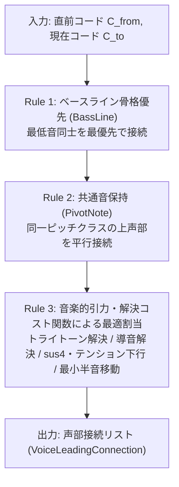

# HarmonyVisualizer 音楽理論モデルと解決アルゴリズム仕様書

本ドキュメントは、**HarmonyVisualizer** における五度圏（Circle of Fifths）の幾何学トポロジー、声部連結（ボイスリーディング）の引力・コスト関数モデル、および 3D タイムトンネルの視覚表現・ライフサイクル制御の理論的根拠を定義する技術仕様書です。

---

## 1. 五度圏（Circle of Fifths）幾何学モデル

### 1.1 ピッチクラスと五度圏インデックスの写像
MIDI ノート番号 $n \in [0, 127]$ からピッチクラス $pc \in [0, 11]$（$\mathrm{C}=0, \mathrm{C\sharp}=1, \dots, \mathrm{B}=11$）を算出し、完全五度（7半音）ごとの円環インデックス $idx \in [0, 11]$ へ写像します。

$$
pc = ((n \bmod 12) + 12) \bmod 12
$$

$$
idx = (pc \times 7) \bmod 12
$$

| 五度圏 Index ($idx$) | 0 | 1 | 2 | 3 | 4 | 5 | 6 | 7 | 8 | 9 | 10 | 11 |
|---|---|---|---|---|---|---|---|---|---|---|---|---|
| **音名 (Note)** | C | G | D | A | E | B | Gb | Db | Ab | Eb | Bb | F |
| **ピッチクラス ($pc$)** | 0 | 7 | 2 | 9 | 4 | 11 | 6 | 1 | 8 | 3 | 10 | 5 |
| **時計角度 ($\theta$)** | $0^\circ$ | $30^\circ$ | $60^\circ$ | $90^\circ$ | $120^\circ$ | $150^\circ$ | $180^\circ$ | $210^\circ$ | $240^\circ$ | $270^\circ$ | $300^\circ$ | $330^\circ$ |

### 1.2 五度圏距離と協和度・音程分類
2つの構成音 $idx_A, idx_B$ 間の五度圏上の最短円環距離 $d \in [1, 6]$ は以下で定義されます。

$$
d = \min\left(|idx_A - idx_B|,\; 12 - |idx_A - idx_B|\right)
$$

五度圏距離 $d$ は、音響学・和声学における**協和度（Consonance）から緊張度（Dissonance / Tension）へのグラデーション**と1対1に対応します。

| 五度圏距離 $d$ | 半音距離 | 代表音程 | 音楽的性質 | カラーパレット（Studio Dark Slate） |
|---|---|---|---|---|
| **0** | 0（同音/Oct） | 完全1度 / 完全8度 | ピボット保持（静止・共通音） | エレクトリックシアン (`#7DD3FC` → `#38BDF8`) |
| **1** | 7 / 5 | 完全5度 / 完全4度 | **最協和**（音響的骨格・空虚五度） | クールシアン (`#38BDF8`) |
| **2** | 2 / 10 | 長2度 / 短7度 | モード的広がり・緩和された緊張 | ウォームアンバー (`#FBBF24`) |
| **3** | 3 / 9 | 短3度 / 長6度 | 柔和な協和（マイナーの色彩） | セージグリーン (`#34D399`) |
| **4** | 4 / 8 | 長3度 / 短6度 | 明朗な協和（メジャーの色彩） | ミントライム (`#A3E635`) |
| **5** | 1 / 11 | 短2度 / 長7度 | **鋭い半音緊張**（導音・M7の摩擦） | ビビッドタンジェリン (`#F97316`) |
| **6** | 6 | 増4度 / 減5度 | **最大緊張（トライトーン）**・中心対角線 | クリムゾンローズ (`#F43F5E`) |

### 1.3 和音構造の幾何学的対称性
五度圏上にプロットされた多角形は、コードネームを介さずに和音の機能的性質を視覚化します。
- **長三和音・短三和音（Major / Minor Triad）**: 距離 $(1, 3, 4)$ の直角に近い非対称三角形（長・短は鏡像反転）。
- **オーギュメント（Augmented Triad）**: 距離 $(4, 4, 4)$ の正三角形（完全対称・調性浮遊）。
- **ディミニッシュ7th（Diminished 7th）**: 距離 $(3, 3, 3, 3)$ で中心を通る2本のトライトーン対角線（$d=6$）が直交する正方形。
- **ドミナント7th（Dominant 7th）**: 3度音と7度音が中心を貫くトライトーン対角線（$d=6$）を形成し、解決への強い推進力を可視化。

---

## 2. ボイスリーディング規則と音楽的引力モデル

直前コード $C_{\text{from}}$（奥）から現在コード $C_{\text{to}}$（手前）への声部連結（`VoiceLeadingSolver`）は、単なる幾何学的距離だけでなく、西洋音楽理論およびジャズ・ポピュラー和声における**声部引力（Melodic Gravity & Harmonic Attraction）**を反映した階層ルールとコスト関数によって決定されます。

### 2.1 ルール優先階層

1. **Rule 1 — ベースラインの骨格優先 (`Type::BassLine`)**:
   - $C_{\text{from}}$ の最低音（`bassNote`）と $C_{\text{to}}$ の最低音は、音程跳躍の大小に関わらず和声進行の土台（Root / Bass Motion）として最優先で1本の太い骨格ラインで接続します。
2. **Rule 2 — 共通音保持 (`Type::PivotNote`)**:
   - 残りの上声部のうち、遷移前後で同一ピッチクラス（$\Delta pc = 0$）を持つノート同士を優先的に平行接続します。
   - 上声部内に同一ピッチクラスの空きがない場合でも、$C_{\text{to}}$ のベース音が同一ピッチクラスであれば（例: $\mathrm{Fm} \to \mathrm{C}$ における上声部 $\mathrm{C}$ 音の保持）、共通音保持として接続します。
3. **Rule 3 — 音楽的引力・解決コスト関数による上声部ペアリング (`Type::TritoneResolution` / `Type::Stepwise` / `Type::Converged`)**:
   - 残りの移動声部 $u \in C_{\text{from}}$ について、候補ターゲット音 $v \in C_{\text{to}}$ への遷移コスト $J(u, v)$ を評価し、全体コスト最小となる接続を求めます。

### 2.2 音楽的引力・解決コスト関数 $J(u, v)$

ピッチクラス空間上の符号付き最短半音変位 $\Delta_{\text{pc}}(u, v) \in [-6, +6]$ を以下のように定義します（正は上行、負は下行）。

$$
\Delta_{\text{pc}}(u, v) = \bigl((pc(v) - pc(u) + 18) \bmod 12\bigr) - 6
$$

単一ペアの基本遷移コスト $C_{\text{pair}}(u, v)$ は、**移動距離コスト**から**音楽的解決ボーナス（引力）**を減算し、**反解決ペナルティ**を加算して算出します。

$$
C_{\text{pair}}(u, v) = C_{\text{dist}}(\Delta_{\text{pc}}, \Delta_{\text{midi}}) - B_{\text{tritone}}(u, v) - B_{\text{leading}}(u, v) - B_{\text{downward}}(u, v) + P_{\text{anti}}(u, v)
$$

#### (1) 基本移動距離コスト $C_{\text{dist}}$（近接移動の法則 / Law of Parsimony）
- $|\Delta_{\text{pc}}| = 1$（半音移動）: 最小基本コスト（`100`）
- $|\Delta_{\text{pc}}| = 2$（全音移動）: 中程度コスト（`220`）
- $|\Delta_{\text{pc}}| \ge 3$（3半音以上の跳躍）: 非線形（二次関数）ペナルティ $220 + 180 \times (|\Delta_{\text{pc}}| - 2)^2$ を課し、不必要な声部跳躍を強く抑止します。
- 実 MIDI ノート差 $|\Delta_{\text{midi}}| = |v - u|$ に微小重み（`×4`）を乗じ、同一ピッチクラス候補間のオクターブ近接タイブレーカーとします。

#### (2) トライトーン解決引力 $B_{\text{tritone}}$ と反解決抑止 $P_{\text{anti}}$
$u \in C_{\text{from}}$ が前コード内でトライトーン（6半音離れたペア）を構成している場合：
- **半音下行解決（$\Delta_{\text{pc}} = -1$）**: 第7音が解決先の第3音へ半音下行する動き（例: $\mathrm{G7} \to \mathrm{CM7}$ における $\mathrm{F} \to \mathrm{E}$）に対して最大の引力ボーナス（`-85`）を付与します。
- **半音上行解決（$\Delta_{\text{pc}} = +1$）**: 第3音（導音）が主音へ半音上行する動き（例: $\mathrm{G7} \to \mathrm{C}$ における $\mathrm{B} \to \mathrm{C}$）に対して強い引力ボーナス（`-80`）を付与します。
- **反解決抑止ペナルティ $P_{\text{anti}}$**: $C_{\text{to}}$ 内に半音解決先（$|\Delta_{\text{pc}}| = 1$）が存在するにもかかわらず、トライトーン構成音が全音上行（$\Delta_{\text{pc}} = +2$、例: $\mathrm{G7} \to \mathrm{CM7}$ で $\mathrm{F}$ が $\mathrm{E}$ を無視して $\mathrm{G}$ へ進む動き）を選択した場合にペナルティ（`+160`）を課します。

#### (3) 導音の上行解決引力 $B_{\text{leading}}$
- トライトーンを含まない三和音等であっても、前コードの長3度音や長7度音が半音上行（$\Delta_{\text{pc}} = +1$）して次コードの根音（ベース音）または構成音へ解決する動き（例: $\mathrm{G} \to \mathrm{C}$ の $\mathrm{B} \to \mathrm{C}$）にボーナス（`-55`）を付与します。

#### (4) 掛留音（sus4）・短6度・テンションの下行解決引力 $B_{\text{downward}}$
- **半音下行解決（$\Delta_{\text{pc}} = -1$）**: 掛留音（$\mathrm{Csus4} \to \mathrm{C}$ の $\mathrm{F} \to \mathrm{E}$）、サブドミナントマイナーの短6度（$\mathrm{Fm} \to \mathrm{C}$ の $\mathrm{A\flat} \to \mathrm{G}$）、フラット9th等の半音下行解決に対して重力ボーナス（`-50`）を付与します。
- **全音下行解決（$\Delta_{\text{pc}} = -2$）**: 9th $\to$ Root や 5th $\to$ 3rd（$\mathrm{G7} \to \mathrm{C}$ の $\mathrm{D} \to \mathrm{C}$）などの全音下行に対してボーナス（`-20`）を付与します。

#### (5) 多対1合流ペナルティとソフト声部交差ペナルティ
複数の移動声部を同時に割り当てる際、従来の「厳密な1対1単調増加制約」では $\mathrm{G7}(\mathrm{D4, F4}) \to \mathrm{CM7}(\mathrm{E4, G4})$ において $\mathrm{D4} < \mathrm{F4}$ かつ $\mathrm{E4} < \mathrm{G4}$ の順序縛りによって $\mathrm{F4} \to \mathrm{E4}$ が禁止され、$\mathrm{F4} \to \mathrm{G4}$ へ強制接続される問題がありました。
本モデルでは以下の全体目的関数を最小化することでこの問題を解決します：

$$
J_{\text{total}} = \sum_{i} C_{\text{pair}}(u_i, v_i) + \sum_{k} P_{\text{converge}}(v_k) + \sum_{i < j} P_{\text{cross}}(u_i, v_i, u_j, v_j)
$$

- **合流ペナルティ $P_{\text{converge}}$（`+45`）**: 同一ターゲット音に複数声部が収束する場合に緩やかなペナルティを加算します。ただしトライトーン半音解決のボーナス（`-85`〜`-135`）の方がはるかに大きいため、$\mathrm{G7} \to \mathrm{CM7}$ では不自然な $\mathrm{F} \to \mathrm{G}$ への逃避よりも $\mathrm{F} \to \mathrm{E}$（および $\mathrm{D} \to \mathrm{E}$ または $\mathrm{D} \to \mathrm{C}$）の解決が優先されます。
- **声部交差ペナルティ $P_{\text{cross}}$（`+35`）**: 声部順序の逆転をハード制約ではなくソフトペナルティとして扱うことで、通常時は自然な声部秩序を保ちつつ、強い解決引力がある場合には音楽理論的に正しい解決を優先します。

---

## 3. 視覚表現・空間演出との対応付け

### 3.1 ボイスリーディング糸の視覚的階層（Multi-layer Bloom）
声部接続種別（`VoiceLeadingConnection::Type`）に応じて、3D トンネル内の「光の糸」の太さ・色彩・減衰耐性を差別化します。

| 接続種別 (`Type`) | 音楽的役割 | 視覚的特徴（太さ・色彩・奥での持続性） |
|---|---|---|
| `BassLine` | 和声進行の土台・根音運動 | 最も太い骨格ライン（`1.65x〜1.85x`）。奥の世代でも減衰しにくい（減衰耐性高）。 |
| `TritoneResolution` | 最大緊張から協和へのカタルシス | クリムゾンローズ（緊張色）からミント/シアン（解決色）へのグラデーション光線（`1.40x〜1.75x`）。 |
| `PivotNote` | 共通音の保持・和声的連結の軸 | 消失点へ向かって真っ直ぐ伸びるエレクトリックシアンの光軸。 |
| `Stepwise` | 滑らかな順次進行（半音・全音） | 五度圏移動距離に応じた調和カラーパレットの光線。 |
| `Converged` | 複数声部の解決音への収束 | 解決先ノードへ吸い込まれる繊細な補助ライン（`0.70x〜0.95x`）。 |

### 3.2 空気遠近法（Aerial Perspective）による3D空間表現
過去コード（世代 $g \ge 1$, 深度 $Z > 0$）は、単純な不透明度（Alpha）の低下だけでなく、深度 $Z$ に応じて**彩度低下（Desaturation）**と**背景色（スレートチャコール `#141720`）への色ブレンド（Fog Interpolation）**を施すことで、トンネルの奥へ行くほど空気の層に霞む立体感を表現します。
- **安定音程（$d \in \{1, 2, 3, 4\}$）**: 空気遠近の影響を100%受け、奥へ行くほど速やかに背景の霧へ溶け込みます。
- **緊張音程（トライトーン $d=6$ / 半音緊張 $d=5$）およびベースライン**: 空気遠近に対する**減衰耐性（Fog Resistance）**を持ち、トンネルの奥深くでもクリムゾンローズの緊張光が微かに発光し続けます。

### 3.3 トライトーン解決追跡とステップ移動アニメーション
- **Z深度イージング補間**: 新しいコードが確定するたびに過去世代の目標深度 `targetZ` がステップ増加し、60Hz タイマー駆動の指数補間（Exponential Lerp）によって奥へ滑らかに後退します。
- **トライトーン解決追跡ライフサイクル**:
  - 通常のコードは規定世代数（`maxHistorySize`）を超えると退役（`isRetiring = true`）し、スムーズにフェードアウトして破棄されます。
  - トライトーンを含む緊張コード（$\mathrm{G7}$ 等）は、後続コードでそのトライトーン構成音が解決されるまで（例: $\mathrm{G7} \to \mathrm{Csus4} \to \mathrm{C}$ のように段階的に解決される進行では $\mathrm{C}$ に到達するまで）退役を保留して奥に保持され、**解決が完結した後にフェードアウトする**音楽理論連動のライフサイクルを持ちます（メモリ保護のためハード上限世代数を設定）。

---

## 4. 未決定事項・今後の検討課題（レビュー確認事項）

1. **コスト関数パラメータの微調整**:
   - 現在 `VoiceLeadingSolver::CostParameters` に定義している各重み（トライトーン半音解決ボーナス `85`、導音ボーナス `55`、sus4下行ボーナス `50`、合流ペナルティ `45`、交差ペナルティ `35`）の実演奏におけるバランス調整。
2. **長距離コード遷移時の第5音（Fifth）の扱い**:
   - $\mathrm{G7}(\mathrm{G, B, D, F}) \to \mathrm{CM7}(\mathrm{C, E, G, B})$ において、上声部の $\mathrm{D}$ 音を $\mathrm{E}$（長3度への合流）と $\mathrm{C}$（根音への全音下行）のどちらへ優先接続するか（現在は実ノート距離と下行ボーナスに応じて自然な側を選択）。
3. **将来拡張（調性・キーセンター推定との連携）**:
   - 過去数世代のピッチクラス分布から現在の調（Key Center）を推定し、ダイアトニック主音・第3音への解決引力を動的に強化する拡張の要否。
