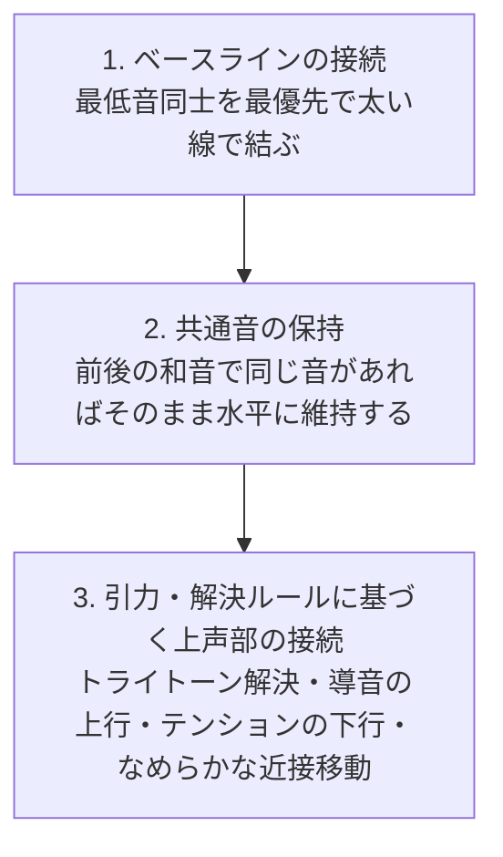

# MeLoom 音楽理論モデルと視覚化仕様書

本ドキュメントは、 **MeLoom** における五度圏（Circle of Fifths）の幾何学配置、声部連結（ボイスリーディング）の音楽的引力モデル、および 3D 空間演出の理論的根拠をまとめた仕様書です。

---

## 1. 五度圏（Circle of Fifths）の幾何学配置

### 1.1 音の配置
西洋音楽の 12 の音（クロマティック）を、完全 5 度（7 半音）の音程間隔で時計回りに円環上に配置します。頂点（12時方向）を **C** とし、右回りに属調方向（シャープ系）、左回りに下属調方向（フラット系）が並びます。

| 時計位置 | 12時 | 1時 | 2時 | 3時 | 4時 | 5時 | 6時 | 7時 | 8時 | 9時 | 10時 | 11時 |
|:---:|:---:|:---:|:---:|:---:|:---:|:---:|:---:|:---:|:---:|:---:|:---:|:---:|
| **音名** | C | G | D | A | E | B | F# / Gb | Db | Ab | Eb | Bb | F |

---

### 1.2 五度圏上の距離と色彩パレット
2 つの音の間の「五度圏上の最短距離（1〜6 ステップ）」は、和声学・音響学における **協和度（心地よさ）から緊張度（濁り・緊張）へのグラデーション** と一致します。
本アプリでは、この関係性を直感的に把握できるよう、以下の色彩で線分を描画します。

| 五度圏距離 | 半音数 | 代表的な音程 | 音楽的な性質 | 画面上の色 |
|:---:|:---:|---|---|---|
| **0** | 0 / 12 | 完全 1 度 / 8 度（同音・オクターブ） | 静止・共通音の保持 | 🔷 **明るい水色** (`#38BDF8`) |
| **1** | 7 / 5 | 完全 5 度 / 完全 4 度 | **もっとも安定した協和**（音響的骨格） | 🔵 **青・水色** (`#38BDF8`) |
| **2** | 2 / 10 | 長 2 度 / 短 7 度 | 柔らかな緊張（9th や 7th の広がり） | 🟡 **黄色・アンバー** (`#FBBF24`) |
| **3** | 3 / 9 | 短 3 度 / 長 6 度 | 柔和な協和（マイナーの響き） | 🟢 **落ち着いた緑** (`#34D399`) |
| **4** | 4 / 8 | 長 3 度 / 短 6 度 | 明るい協和（メジャーの響き） | 🌱 **黄緑・ライム** (`#A3E635`) |
| **5** | 1 / 11 | 短 2 度 / 長 7 度 | **鋭い緊張**（半音のぶつかり・導音の摩擦） | 🟠 **オレンジ** (`#F97316`) |
| **6** | 6 | 増 4 度 / 減 5 度（トライトーン） | **最大の緊張**（円の真向かい・中心を通る対角線） | 🔴 **赤・クリムゾン** (`#F43F5E`) |

---

### 1.3 和音（コード）が描く幾何学模様
五度圏上に音をプロットして結ぶと、コードネームを見なくても **和音の機能や響きの性質が図形の形としてひと目でわかります** 。

- **メジャーコード（長三和音）とマイナーコード（短三和音）**
  - メジャーコード（例: C = C, E, G）とマイナーコード（例: Cm = C, Eb, G）は、五度圏の垂直軸を基準に **左右対称（鏡像）の三角形** を描きます。
- **オーギュメント（増三和音）**
  - 4 半音（長 3 度 = 五度圏で 4 ステップ）の連続により、円の中に **完全な正三角形** を描きます（調性的な中心がない浮遊感）。
- **ディミニッシュ 7th（減七の和音）**
  - 3 半音（短 3 度 = 五度圏で 3 ステップ）の連続により、円の中心を通る 2 本のトライトーン対角線が直交する **正方形** を描きます。
- **ドミナント 7th（属七の和音）**
  - 第 3 音と第 7 音（例: G7 の B と F）が円の中心を貫く **真っ赤な対角線（トライトーン）** を形成し、次の和音へ解決しようとする強い推進力が視覚化されます。

---

## 2. 声部連結（ボイスリーディング）と音楽的引力

前の和音から次の和音へ移るとき、各声部がどのように滑らかに繋がるかを決定するルールです。
単に物理的な近さだけでなく、クラシック和声やジャズで重視される **声部の引力（解決への推進力）** に基づいて接続線を結びます。

### 2.1 接続の優先順位

1. **ベースラインの優先**
   - 和声進行の土台である最低音（ベース音）同士を、跳躍の大きさに関わらず最優先で 1 本の太い骨格ラインで接続します。
2. **共通音の保持（ピボットノート）**
   - 前の和音と次の和音に同じ音（例: C メジャーから F メジャーへ進むときの C 音）が含まれる場合、その音をそのまま同じ位置へ真っ直ぐ水平にキープします。
3. **上声部のなめらかな接続と解決**
   - 残りの動く声部について、以下の「音楽的引力」を最優先しながら、自然で美しい声部の流れを作ります。

---

### 2.2 音楽的引力（解決と進行のルール）

#### (1) トライトーンの解決（最強の引力）
ドミナント 7th 和音に含まれるトライトーン（増 4 度 / 減 5 度）は、次のように半音で反進行して安定した協和音へ解決しようとする極めて強い引力を持ちます。
- **第 7 音の半音下行** : 例として G7 → C の進行では、第 7 音の **F** が半音下の **E** （3度音）へ強く引き寄せられます。
- **第 3 音（導音）の半音上行** : 第 3 音の **B** が半音上の **C** （主音）へ強く引き寄せられます。
- **不自然な跳躍の抑止** : すぐ近くに美しい解決音があるにもかかわらず、別の音へ遠回りして逃げるような不自然な動きを防止します。

#### (2) 導音（リーディングトーン）の上行解決
トライトーンを含まない和音であっても、音階の第 7 音（導音）や和音の長 3 度音が、次の和音の主音へ半音上行（例: G → C における B → C）する自然な流れを優先します。

#### (3) 掛留音（サスペンション）やテンションの下行解決
- **sus4 の解決** : Csus4 → C において、第 4 音の **F** が第 3 音の **E** へ半音下行する動き。
- **サブドミナントマイナーの哀愁** : Fm → C において、短 6 度の **Ab** が完全 5 度の **G** へ半音下行して寄り添う動き。
- **9th や 5th の全音下行** : 緊張音や経過音が 1 音（全音）下がって落ち着く動き。

#### (4) 声部の秩序（声部交差の防止となめらかな移動）
- 声部の上下関係が不自然に入れ替わる「声部交差」を避け、各声部が可能な限り小さな音程移動（半音または全音）で自然に次の音へ移るようにします。

---

## 3. 画面の立体演出とライフサイクル

### 3.1 光の糸の階層表現
声部を結ぶ「光の糸」は、音楽的な重要度に応じて太さや色合いを変えて描画されます。

| 声部の役割 | 音楽的な意味 | 画面上の見た目 |
|---|---|---|
| **ベースライン** | 和音の根底を支える動き | 最も太く力強いライン。奥へ行っても消えにくい。 |
| **トライトーン解決** | 最大の緊張から安息へのカタルシス | 🔴 **赤（緊張）** から 🔵 **青/緑（解決）** へ変化する鮮やかなグラデーション光線。 |
| **共通音の保持** | 和音を繋ぎとめるアンカー（軸） | 消失点に向かって真っ直ぐ伸びる 🔷 **明るい水色の光軸** 。 |
| **順次進行（ステップ移動）** | 半音や全音のなめらかな移動 | 音程の移動距離に応じた調和カラーの光線。 |
| **声部の合流** | 複数の音が 1 つの解決音に集まる動き | 解決先の音へ吸い込まれる繊細な光の糸。 |

---

### 3.2 奥行きと空気遠近法（立体感の演出）
過去に弾いたコードは、タイムトンネルの奥へ向かって進んでいきます。
- **奥に行くほど霞む演出**
  - 単に透明度を下げるだけでなく、奥へ行くほど彩度が落ち着き、背景の深いダークグレーへ自然に溶け込む「空気遠近法」を適用しています。
- **緊張感の残存**
  - 安定した響きは静かに背景の霧へ溶け込んでいくのに対し、 **未解決のトライトーン（赤い対角線）やベースライン** は霧の奥深くでも微かに発光し続け、「解決を待っている緊張状態」が空間の中に残ります。

---

### 3.3 トライトーンの解決追跡（ライフサイクル）
和音が時間とともに奥へ流れて消える際にも、音楽理論に基づいた演出を行っています。
- **通常の和音**
  - 一定の世代数が経つと、奥へ滑らかにフェードアウトして消えていきます。
- **トライトーンを持つ緊張和音**
  - 後続の和音によってトライトーンが解決されるまで、通常よりも長く奥にとどまり続けます。
  - 例えば `G7 → Csus4 → C` と進行した場合、`Csus4` の時点ではまだ完全には緊張が解消されていないため、奥に `G7` の緊張が残り、完全に `C` メジャーに解決した段階で役目を終えて穏やかにフェードアウトします。

---

## 4. 将来構想（今後のアップデート計画）

### 4.1 外声（ソプラノライン）の強調
現在は最低音（ベース）を最も太い骨格として強調していますが、人間の耳に最もメロディとして届きやすい **最高音（ソプラノライン）** についても、ベースラインと同様に目立たせて追従する表現を検討しています。

### 4.2 キー推定とトンネルの動的回転（Z 軸回転トポロジー）
- **常に主音（キー / ルート）が真上（12時）に来る動的回転**
  - 演奏中のコード進行から、現在の調性（キーセンター）や和音のルートをリアルタイムに自動推定します。
  - そして、その基準となる音が **常に五度圏の真上（12時方向）** に位置するように、 **タイムトンネル全体が滑らかに回転する演出** を計画しています。
  - これが実現すると、転調しても常に「真上 = 主音（I 度）」という基準（ディグリー感覚）が保たれ、あらゆる調の音楽を統一的な幾何学関係として直感的に楽しむことができるようになります。
